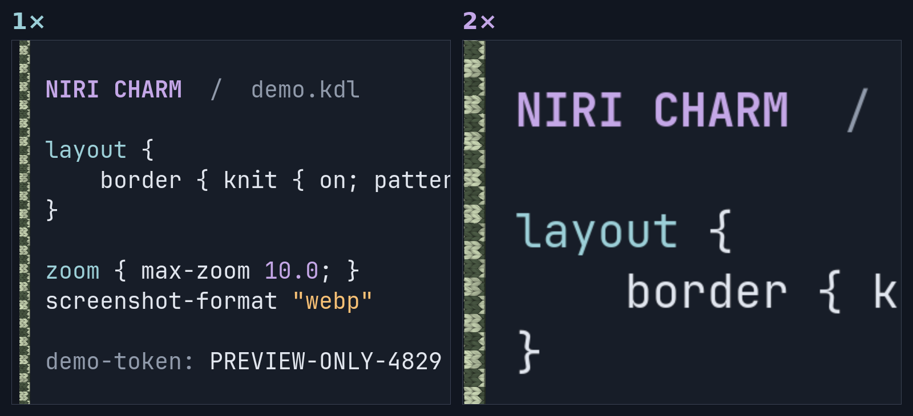
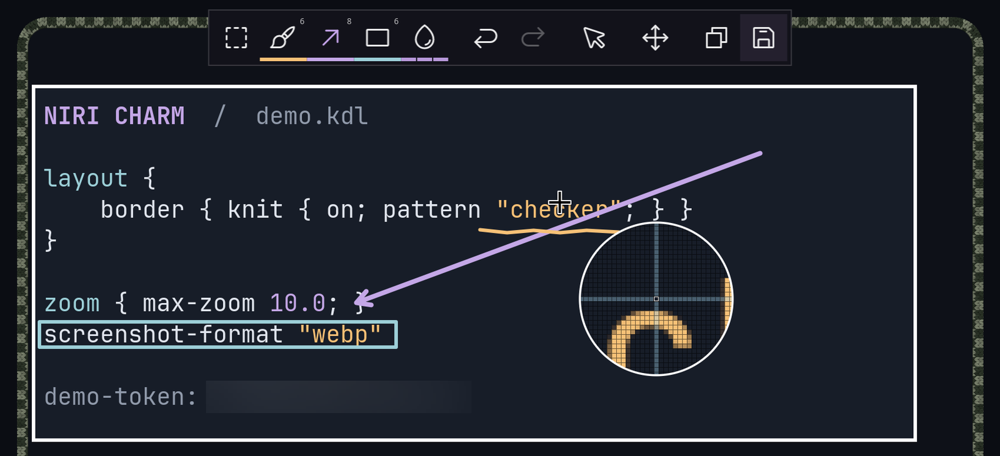
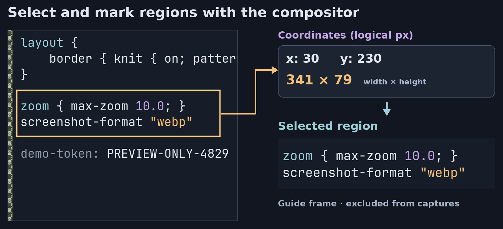

<div align="center">
  <picture>
    <source media="(prefers-reduced-motion: reduce)" srcset="docs/wiki/logo/niri-logo.svg">
    
  </picture>
  <h1>niri-charm</h1>
  <p>A <a href="https://github.com/niri-wm/niri">niri</a> fork with <strong>knitted borders, desktop zoom, a screenshot editor, and region-selection IPC.</strong></p>
  <p>Installs alongside stock niri, with its own session and config.</p>
  <p>
    <a href="#what-the-fork-adds">What the fork adds</a> ·
    <a href="#install">Install</a> ·
    <a href="#configure">Configure</a> ·
    <a href="#wiki">Wiki</a>
  </p>
</div>

## What the fork adds

<table>
  <tr>
    <td width="50%" valign="top">
      <a href="docs/assets/knit-patterns.webp"></a>
      <h3>Knitted borders</h3>
      <p>Six yarn patterns with per-app colours. Borders follow window geometry and animations; changes reload live.</p>
      <p><a href="#knit">Enable</a> · <a href="docs/wiki/Knitted-Border-Tuning.md">Wiki</a> · <a href="https://github.com/user-attachments/assets/7dcf712c-5059-4ca8-9076-512646c47815">Demo</a></p>
    </td>
    <td width="50%" valign="top">
      <a href="docs/assets/zoom-preview.webp"></a>
      <h3>Desktop zoom</h3>
      <p>Magnify without resizing windows. Use keys, the wheel, or pinch; follow the pointer, lock the view, or zoom temporarily while holding a key.</p>
      <p><a href="#zoom">Enable</a> · <a href="docs/wiki/Accessibility.md#desktop-zoom">Wiki</a> · <a href="docs/assets/zoom_demonstration.mp4">Demo</a></p>
    </td>
  </tr>
  <tr>
    <td width="50%" valign="top">
      <a href="docs/assets/screenshot-editor-preview.webp"></a>
      <h3>Crop and annotate screenshots</h3>
      <p>Draw, add arrows and shapes, blur regions, and undo edits without opening another app. Inspect pixels with the magnifier; export PNG, WebP, or AVIF.</p>
      <p><a href="#screenshot-editor">Enable</a> · <a href="docs/wiki/Configuration:-Screenshot.md">Wiki</a></p>
    </td>
    <td width="50%" valign="top">
      <a href="docs/assets/region-ipc-preview.webp"></a>
      <h3>Select and mark screen regions</h3>
      <p>Select a desktop area and get its coordinates over IPC, or outline it with a compositor-drawn frame. Reuse the region in scripts, screenshots, or recording; the frame stays out of Niri captures.</p>
      <p><a href="#region-ipc">Use</a> · <a href="docs/wiki/IPC.md#region-selection-and-recording-frame">Wiki</a></p>
    </td>
  </tr>
</table>

## Install

### Linux (systemd)

Install [Rust](https://rustup.rs/), Git, and the [build dependencies](docs/wiki/Getting-Started.md#building), then run:

```sh
git clone https://github.com/TOwInOK/niri-sweaters.git niri-charm
cd niri-charm
./scripts/install-niri-charm
```

The installer builds the fork and requests elevated permissions through `pkexec` or `run0` to install its binary and session files. It does not replace stock niri.

<details>
<summary><strong>NixOS (flake)</strong></summary>

Merge this input and module into your system flake, replacing `your-host` with your configuration name:

```nix
{
  inputs.niri-charm.url = "github:TOwInOK/niri-sweaters";

  outputs = { nixpkgs, niri-charm, ... }: {
    nixosConfigurations.your-host = nixpkgs.lib.nixosSystem {
      system = "x86_64-linux";
      modules = [
        ./configuration.nix
        niri-charm.nixosModules.default
      ];
    };
  };
}
```

```sh
sudo nixos-rebuild switch --flake .#your-host
```

</details>

Log out and select **Niri Charm** in your display manager. On first login, your existing niri config is copied to `~/.config/niri-charm/` without overwriting existing files. If there is no niri config, the session uses the bundled default.

**Upgrading from Niri Sweaters:** before your first Charm login, copy your complete `niri-sweaters` config directory (including included files) to `niri-charm` under `$XDG_CONFIG_HOME` or `~/.config`. Do not overwrite an existing Charm config. This installer leaves the old session and its files untouched.

## Configure

Edit `~/.config/niri-charm/config.kdl` (or `$XDG_CONFIG_HOME/niri-charm/config.kdl`). Changes reload live. **Merge these snippets into your existing sections; do not duplicate `layout`, `binds`, or key bindings.**

After editing, validate the config with the fork's binary:

```sh
niri-charm validate --config ~/.config/niri-charm/config.kdl
```

### Knit

Enable the border and choose a pattern and two yarn colours:

```kdl
layout {
    focus-ring { off; }
    border {
        on
        width 24
        active-color "#465440"
        inactive-color "#384136"
        knit {
            on
            pattern "checker"
            accent-color "#bac6a6"
            stitch-size 8
        }
    }
}
```

[Per-app rules](docs/wiki/Configuration:-Window-Rules.md#focus-ring-and-border) · [Size and colour guide](docs/wiki/Knitted-Border-Tuning.md) · [Desktop example](docs/assets/knit-desktop.png) · [Example config](resources/knit-preview.kdl)

### Zoom

Toggle 2× with `Mod+Z`, hold `Mod+X` for temporary zoom, or use `Mod` + mouse wheel. `Mod+Shift+Z` locks pointer-follow; `Mod+0` resets the view.

```kdl
binds {
    Mod+Z { zoom 2.0; }
    Mod+X { zoom 2.0 hold=true; }
    Mod+Shift+Z { zoom-lock; }
    Mod+0 { reset-zoom; }
    Mod+WheelScrollUp { zoom-in; }
    Mod+WheelScrollDown { zoom-out; }
}
```

[Pinch gestures, per-monitor behaviour and capture rules](docs/wiki/Accessibility.md#desktop-zoom) · [All zoom actions](docs/wiki/Configuration:-Key-Bindings.md#zoom)

### Screenshot editor

`Print` opens the editor. Pick tools from the toolbar; the editing and export shortcuts below only take effect while the editor is open.

```kdl
screenshot-format "png" // or "webp" / "avif"; clipboard always uses PNG

binds {
    Print { screenshot; }
    Ctrl+Z { screenshot-undo; }
    Ctrl+Shift+Z { screenshot-redo; }
    Ctrl+C { confirm-screenshot write-to-disk=false; }
    Ctrl+S { confirm-screenshot; }
    Return { screenshot-confirm; }
    Escape { screenshot-cancel; }
}
```

`Ctrl+C` copies; `Ctrl+S` saves and copies. Finish the current drawing gesture before exporting. **Blur is not secure redaction:** sensitive information may still be recoverable.

[Toolbar, colours, guides and magnifier](docs/wiki/Configuration:-Screenshot.md) · [All editor actions](docs/wiki/Configuration:-Key-Bindings.md#screenshot-screenshot-screen-screenshot-window)

### Region IPC

No config block is needed. Run these commands in a Niri Charm session to select an area and show its frame (requires `jq`):

```sh
region=$(niri-charm msg --json select-region) || exit 1
printf '%s\n' "$region" | jq -c '{RegionFrame:{Set:{region:.,color:"red"}}}' | niri-charm msg raw-request
```

This does **not** start recording. Clear the frame when finished with `niri-charm msg region-frame clear`. For coordinates only, use `niri-charm msg select-region --format slurp`.

[Coordinate systems, zoom locking and recorder integration](docs/wiki/IPC.md#region-selection-and-recording-frame)

## Wiki

These links point to the fork's documentation, including its added settings and actions:

| Feature           | Guide                                                                                  | Reference                                                                                                               |
| ----------------- | -------------------------------------------------------------------------------------- | ----------------------------------------------------------------------------------------------------------------------- |
| Knitted borders   | [Sizes, patterns and palettes](docs/wiki/Knitted-Border-Tuning.md)                     | [All knit options](docs/wiki/Configuration:-Layout.md#procedural-knit-border)                                           |
| Desktop zoom      | [Controls and behaviour](docs/wiki/Accessibility.md#desktop-zoom)                      | [Settings](docs/wiki/Configuration:-Miscellaneous.md#zoom-1) · [Actions](docs/wiki/Configuration:-Key-Bindings.md#zoom) |
| Screenshot editor | [Tools and appearance](docs/wiki/Configuration:-Screenshot.md)                         | [Bindings and export](docs/wiki/Configuration:-Screenshot.md#opening-bindings-and-export)                               |
| Region IPC        | [Selection and recording frame](docs/wiki/IPC.md#region-selection-and-recording-frame) | [Coordinate formats and capture guidance](docs/wiki/IPC.md#region-selection-and-recording-frame)                        |

[Full demo config](resources/knit-desktop.kdl) — starts sample applications; copy the settings you need rather than replacing your config wholesale.

## Upstream talk

[How to test a Wayland compositor?](https://youtu.be/w44fYK5z418?list=PLK4NE4dSsLlw) · _October 2026_

Ivan Molodetskikh explains niri's property-based, snapshot and client-server tests. The first half overlaps with his RustCon talk; the second half is new. The talk is in Russian with English subtitles.

_note_: btw good to know.

## License

Based on [niri](https://github.com/niri-wm/niri) by Ivan Molodetskikh and contributors. Inspired by [window-sweaters](https://github.com/saragordic/window-sweaters). [GPL-3.0-or-later](LICENSE).

Logo adapted from the [niri project artwork](docs/wiki/Name-and-Logo.md), with an animated glint overlay; licensed under [CC BY-SA 4.0](https://creativecommons.org/licenses/by-sa/4.0/).
