### Overview

The root `screenshot { ... }` block customizes the built-in interactive screenshot editor: its toolbar, tooltips, selection, brush, arrow, rectangle, blur, axis guides and magnifier. It does not affect the appearance of non-interactive `screenshot-screen` or `screenshot-window` captures.

Place this block at the top level of `config.kdl`, alongside `binds`, not inside it. All sections and settings are optional; specify only what you want to change.

The toolbar, selection frame, dimming, axis guides, brush cursor and magnifier are UI overlays and are not included in the exported image. Drawings, shapes and blur edits are included.

The available tools are Select, Draw, Arrow, Rectangle and Blur. Text annotations are not implemented.

### Visual guide

<p>Open the editor with <code>Print</code>, select an area, then annotate it or export it. The captures below use demo content in a real Niri Charm session, with editor controls and configuration examples shown alongside the results. Numbered circles are documentation labels, not extra UI controls. Click any image for full size.</p>

[Toolbar buttons](#toolbar-buttons) · [Color palette](#color-palette) · [Widths and magnifier](#adjusting-tools-and-the-magnifier) · [Panel placement](#toolbar-placement-examples) · [Margins and padding](#toolbar-spacing-and-padding) · [UI colors](#interface-color-examples) · [Tool colors](#independent-tool-colors) · [Custom palettes](#custom-color-palettes) · [Blur levels](#blur-strength-examples) · [Undo/redo](#undo-and-redo) · [Axes: Arrow, Draw, Rectangle](#drawing-with-axis-guides) · [Cursor](#including-the-captured-cursor) · [Export](#copy-save-and-cancel) · [Configuration reference](#default-configuration)

[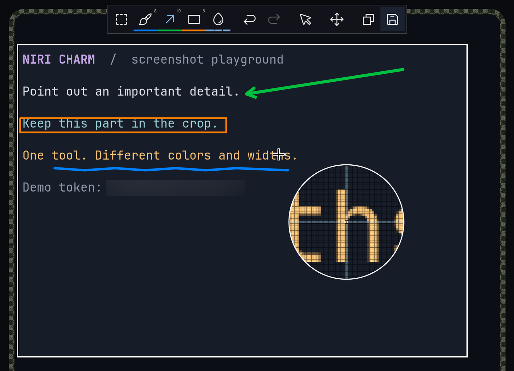](./img/screenshot-editor-overview.png)

The white frame is the crop. The arrow, rectangle, freehand line and blur are edits that will be exported. The toolbar, dimming, crop frame and magnifier are only editing aids.

### Toolbar buttons

<p>The panel groups five tools, history controls, cursor and axes toggles, then Copy and Save. The numbers above the image match the table below. The small numbers inside the drawing-tool buttons are stroke widths in captured-image pixels.</p>

[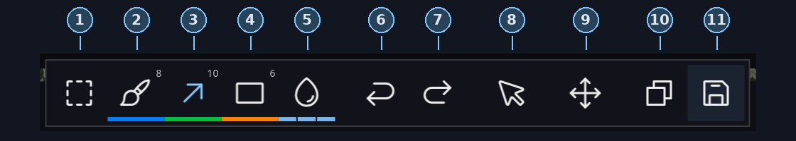](./img/screenshot-toolbar.png)

| No. | Button | What it does | Bundled shortcut |
| --- | --- | --- | --- |
| 1 | **Select** | Drag to choose the crop. Hold `Space` while dragging to move the existing crop instead of drawing a new one. | `V`; hold `Space` to move |
| 2 | **Draw** | Draw a freehand stroke, or click for a dot. Activate the selected button again to open its color palette. | `B` |
| 3 | **Arrow** | Drag from the tail to the arrowhead. It has its own color, width and palette. | `A` |
| 4 | **Rectangle** | Drag between opposite corners to draw an outline; it has no fill. It also has independent color, width and palette settings. | `D` |
| 5 | **Blur** | Drag a rectangle to blur the frozen image beneath the drawings. The three segments below the icon show Low, Medium or High strength. Clicking this button selects Blur; it does not cycle the strength. | `R` |
| 6 | **Undo** | Remove the last completed drawing or blur edit. During a gesture, discard the unfinished edit instead. Grey means there is nothing to undo. | `Ctrl+Z` |
| 7 | **Redo** | Restore the last undone edit. Grey means there is nothing to redo. A new completed edit clears the redo history. | `Ctrl+Shift+Z` or `Ctrl+Y` |
| 8 | **Cursor** | Include or exclude the pointer captured when the editor opened. An accent stripe below the icon means it is included; the icon itself stays the same. | `P` |
| 9 | **Axes** | Toggle horizontal/vertical drawing constraints for Draw, Arrow and Rectangle. This is **not** the crop-move button. An accent stripe means the mode is enabled. | `X`; hold `Shift_L` temporarily |
| 10 | **Copy** | Copy the current crop and edits to the clipboard as PNG, without creating a file. | `Ctrl+C` |
| 11 | **Save** | Save the crop and edits to the configured file path and also copy them to the clipboard. Finish any active gesture first. | `Ctrl+S`; `Enter` when no control is keyboard-focused |

These are **configured bindings from the bundled default config**, not hidden hard-coded keys. Existing configs need the editor bindings; see [Key Bindings](./Configuration:-Key-Bindings.md#screenshot-screenshot-screen-screenshot-window). Editor-local bindings do not take over the same keys in applications when the editor is closed.

The active tool's **icon** uses the accent color. The bottom stripe on Draw, Arrow and Rectangle shows that tool's **drawing color**, which can be different from the accent. Cursor and Axes use their stripe as an on/off indicator instead. Blur uses one, two or three filled segments.

### Color palette

<p>The color menu belongs to the selected Draw, Arrow or Rectangle tool. It is a palette of configured swatches, not a separate text, fill or eyedropper tool. Each colored tool keeps its own color, width and palette.</p>

[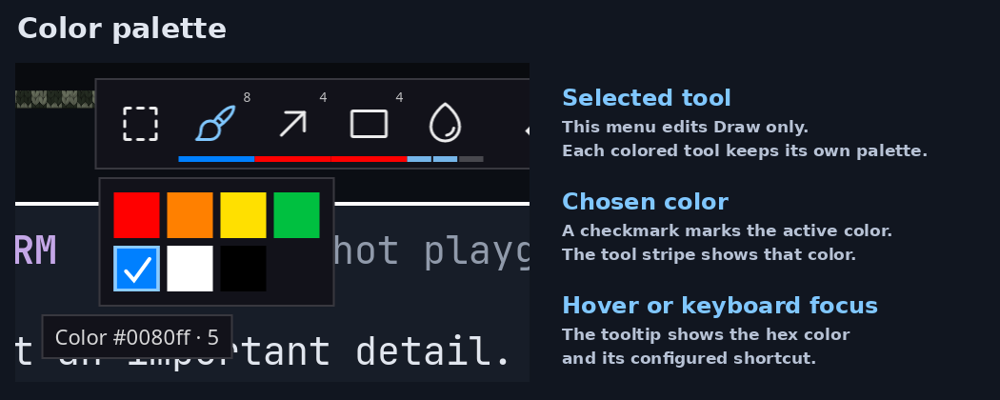](./img/screenshot-palette.png)

1. Select **Draw**, **Arrow** or **Rectangle**. Selecting a different tool does not open the menu.
2. Click that selected tool again, or press `C`, to open its palette. There is no separate palette button in the main toolbar. Repeated-click opening depends on `open-palette-on-click`.
3. Click a swatch, or use the configured `1`–`7` bindings while the palette is open. The order follows the configured palette: left to right, then the next row. A border and checkmark identify the active color.
4. By default, choosing a color closes the menu. Set `close-palette-on-select false` to keep it open. Clicking outside the menu dismisses it without painting; start a new gesture to draw.
5. Draw a new stroke to use the chosen color. Existing edits are not recolored. Switching tools preserves each tool's current color and width.

Hovering a swatch or focusing it with the keyboard shows its hex color and configured shortcut. `Tab` / `Shift+Tab` cycle through enabled toolbar controls and then the open palette; `Enter` activates the focused control. `Escape` closes the palette first. Keyboard focus has an extra accent outline and does not by itself change the active tool.

The palette accepts **one to seven opaque colors** per tool. To change the available swatches, edit that tool's `palette` in the config; see [Brush, arrow and rectangle](#brush-arrow-and-rectangle). The menu edits only the active colored tool, not every tool at once.

### Adjusting tools and the magnifier

<p>The wheel and <code>Minus</code>/<code>Equal</code> bindings adjust a value according to context. Hover the control you want to change; the selected drawing tool does not have to change.</p>

- Over **Draw**, **Arrow** or **Rectangle**, adjust that tool's width. The number above its icon changes; new strokes use the new value.
- Over **Blur**, adjust strength between Low, Medium and High. It stops at the endpoints rather than wrapping.
- Over the **canvas**, adjust the pixel magnifier through `1×`, `2×`, `4×`, `8×`, `16×`, `32×`, up to the configured limit. It starts hidden at `1×` with the default settings and appears from `2×`.
- Over Select, palette controls or other toolbar UI, the context action does not zoom the canvas.

**Keyboard focus takes priority over hover.** Move the mouse to clear keyboard focus and return to pointer-based adjustment. This is magnifier zoom, not desktop zoom. The lens shows the frozen image plus edits, and it never appears in the export.

### Toolbar placement examples

<p>The panel can sit at either screen edge with left, center or right alignment. These six real captures use the same screenshot and crop; only <code>position</code> and <code>align</code> inside <code>screenshot.toolbar</code> change. The palette and tooltips follow the panel and open toward the center of the screen.</p>

<table>
  <tr>
    <td width="33%" valign="top">
      <a href="./img/screenshot-toolbar-top-left.png">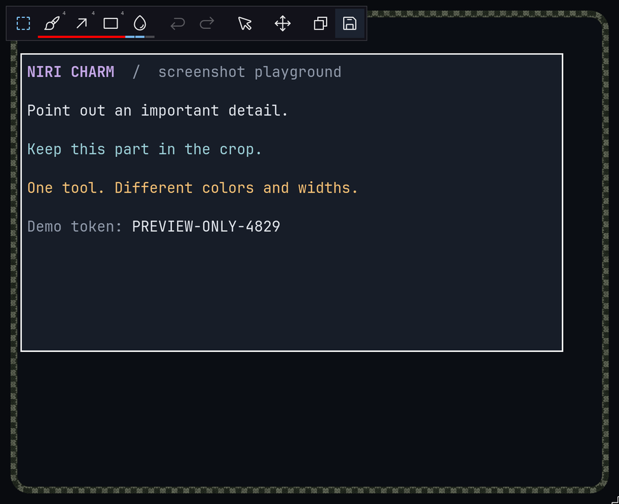</a>
      <h4>Top left</h4>
      <p><code>position "top"</code>, <code>align "left"</code>. The panel follows the top and left margins.</p>
    </td>
    <td width="33%" valign="top">
      <a href="./img/screenshot-toolbar-top-center.png">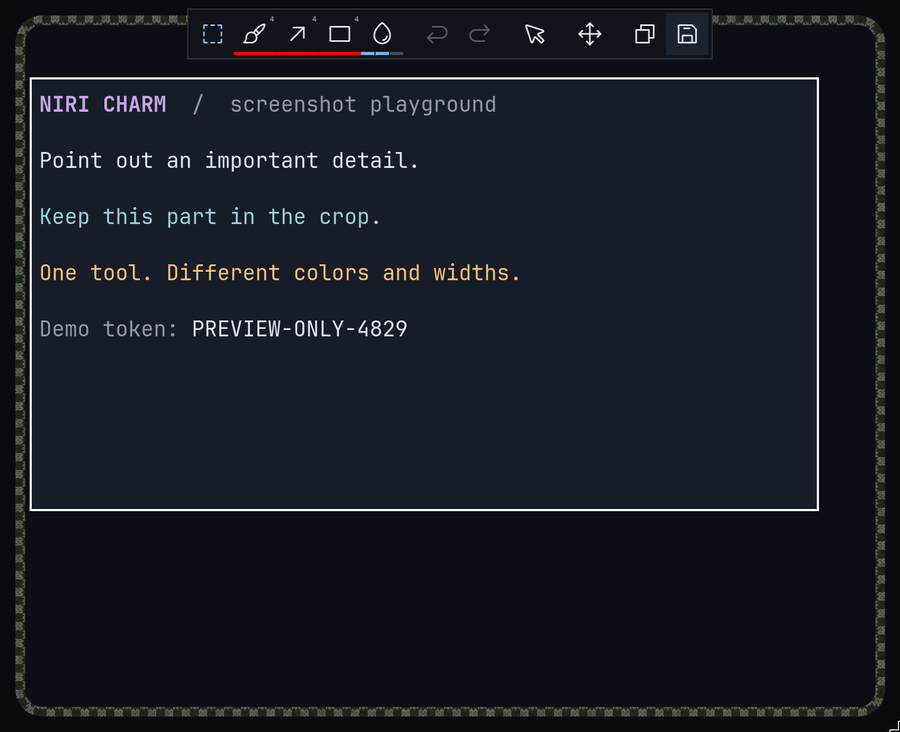</a>
      <h4>Top center</h4>
      <p><code>position "top"</code>, <code>align "center"</code>. This is the default placement.</p>
    </td>
    <td width="33%" valign="top">
      <a href="./img/screenshot-toolbar-top-right.png">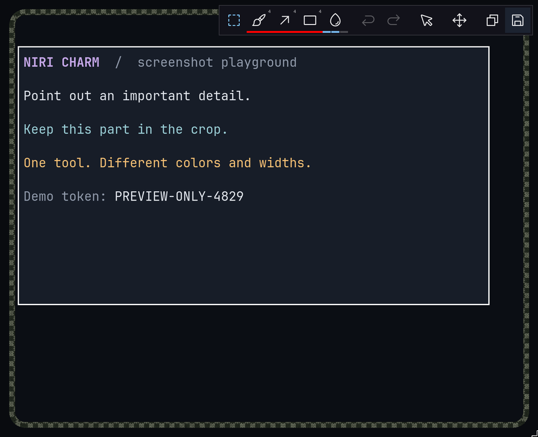</a>
      <h4>Top right</h4>
      <p><code>position "top"</code>, <code>align "right"</code>. The panel follows the top and right margins.</p>
    </td>
  </tr>
  <tr>
    <td width="33%" valign="top">
      <a href="./img/screenshot-toolbar-bottom-left.png">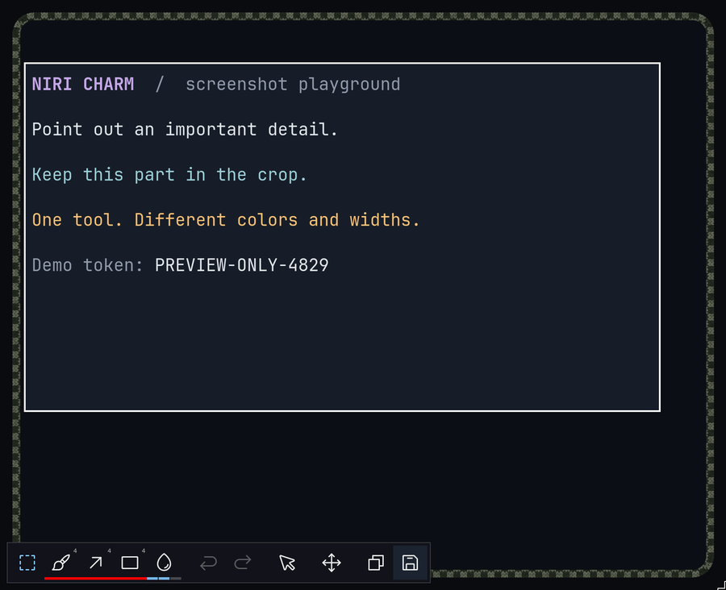</a>
      <h4>Bottom left</h4>
      <p><code>position "bottom"</code>, <code>align "left"</code>. Menus open upward, away from the bottom edge.</p>
    </td>
    <td width="33%" valign="top">
      <a href="./img/screenshot-toolbar-bottom-center.png">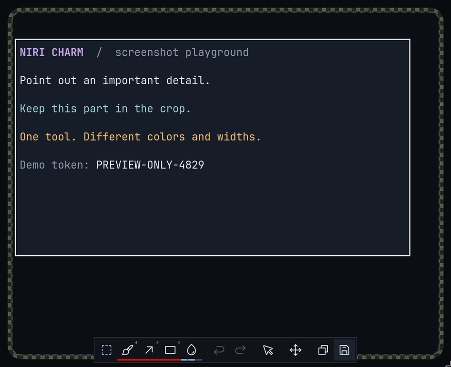</a>
      <h4>Bottom center</h4>
      <p><code>position "bottom"</code>, <code>align "center"</code>. Center the panel between the horizontal margins.</p>
    </td>
    <td width="33%" valign="top">
      <a href="./img/screenshot-toolbar-bottom-right.png">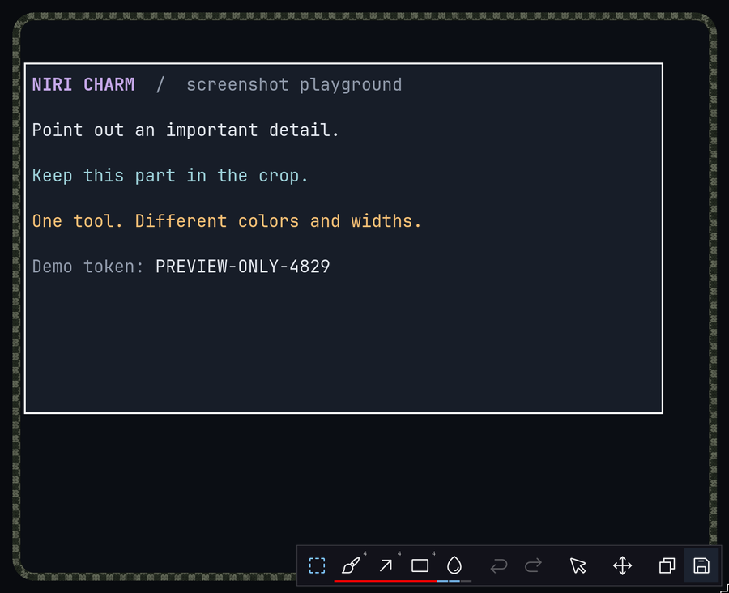</a>
      <h4>Bottom right</h4>
      <p><code>position "bottom"</code>, <code>align "right"</code>. The panel follows the bottom and right margins.</p>
    </td>
  </tr>
</table>

For example:

```kdl
screenshot {
    toolbar {
        position "bottom"
        align "right"
    }
}
```

Merge this into your existing `screenshot` block. Margins, sizes, colors and opacity are independent settings; see [Toolbar](#toolbar) and the [Customization example](#customization-example). Placement updates in an open editor after config reload, but waits until an active gesture ends.

### Toolbar spacing and padding

<p><code>margin</code> controls the distance from the output edges, not the space inside the panel. These crops keep top-left placement and the same button/icon sizes; only the margins change. Values are logical pixels, so the 2× output used here doubles their visible pixel distance.</p>

<table>
  <tr>
    <td width="33%" valign="top">
      <a href="./img/screenshot-toolbar-margin-8.png">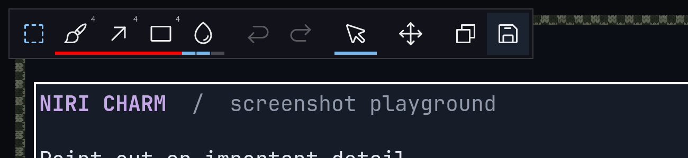</a>
      <h4>Small outer margins</h4>
      <p>All four margins are <code>8</code>, the default. The panel stays close to the top-left output corner.</p>
    </td>
    <td width="33%" valign="top">
      <a href="./img/screenshot-toolbar-margin-40.png">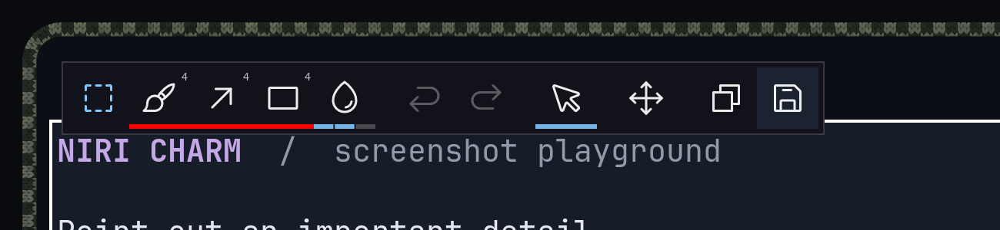</a>
      <h4>More outer space</h4>
      <p>All four margins are <code>40</code>. The whole panel moves inward; its buttons and internal spacing do not grow.</p>
    </td>
    <td width="33%" valign="top">
      <a href="./img/screenshot-toolbar-margin-asymmetric.png">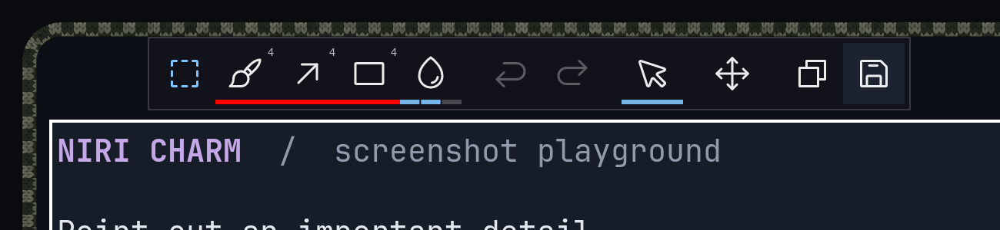</a>
      <h4>Independent sides</h4>
      <p><code>top=24</code>, <code>left=96</code>, <code>right=8</code>, <code>bottom=8</code>. Horizontal and vertical offsets are independent.</p>
    </td>
  </tr>
</table>

The third example uses:

```kdl
screenshot {
    toolbar {
        position "top"
        align "left"
        margin top=24 right=8 bottom=8 left=96
    }
}
```

There is **no configurable `padding` or group-gap setting**. Inner edge padding and gaps between button groups are fixed. To change the space around each icon, adjust `button-size` and `icon-size`: larger buttons with the same icon size leave more room inside each button. `icon-size` must not exceed `button-size`. See [Toolbar](#toolbar) for alignment and small-output behavior.

### Interface color examples

<p>UI colors are separate from drawing colors. These captures keep the same crop, red annotations and 8× magnifier while reloading the interface theme. The toolbar, selection frame, outside dimming and magnifier change; the existing drawings do not.</p>

<table>
  <tr>
    <td width="50%" valign="top">
      <a href="./img/screenshot-theme-dark.png">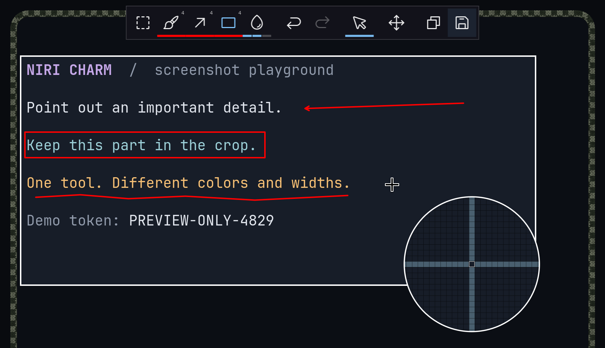</a>
      <h4>Default dark UI</h4>
      <p>A dark panel, pale-blue active icon, white crop and lens borders, and black dimming. Red remains the drawing color.</p>
    </td>
    <td width="50%" valign="top">
      <a href="./img/screenshot-theme-light.png">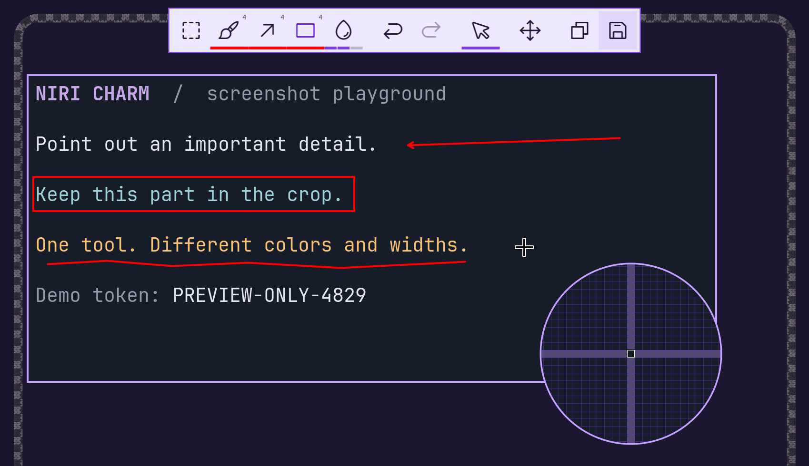</a>
      <h4>Light violet UI</h4>
      <p>A light panel with dark icons, violet accent, crop frame, dimming and magnifier grid. None of this recolors the red edits.</p>
    </td>
  </tr>
</table>

Merge these settings into your existing `screenshot` block for the light variant:

```kdl
screenshot {
    toolbar {
        background-color "#eee9ff"
        border-color "#7c3aed"
        accent-color "#6d28d9"
        icon-color "#24153b"
        disabled-icon-color "#24153b66"
        hover-color "#6d28d91f"
        pressed-color "#6d28d940"
    }
    selection {
        border-color "#c4a0ff"
        dim-color "#201038"
        dim-opacity 0.55
    }
    magnifier {
        border-color "#c4a0ff"
        grid-color "#6d28d980"
        cross-highlight-color "#c4a0ff59"
    }
}
```

The palette and tooltips share the toolbar theme. `accent-color` highlights an active control; it is **not** a brush color. Axis guides have their own `axes.color` and `axes.opacity`. UI colors can include alpha; see [Units and colors](#units-and-colors).

### Independent tool colors

<p>Draw uses the <code>brush</code> configuration block; Arrow and Rectangle use their own blocks. Here Draw is blue, Arrow is green and Rectangle is orange, all at width 8. Each capture opens a different tool's palette: its checkmark and bottom stripe show that tool's color while the other edits keep theirs.</p>

<table>
  <tr>
    <td width="33%" valign="top">
      <a href="./img/screenshot-tool-colors-draw.png">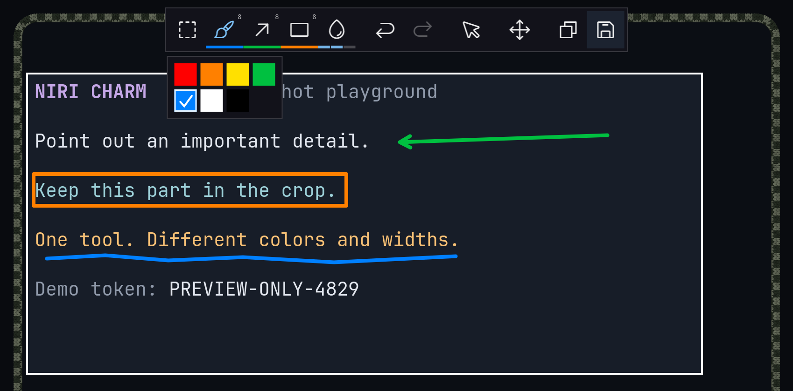</a>
      <h4>Draw: blue</h4>
      <p><code>brush.color "#0080ff"</code> sets the initial freehand color. The blue checkmark belongs only to Draw.</p>
    </td>
    <td width="33%" valign="top">
      <a href="./img/screenshot-tool-colors-arrow.png">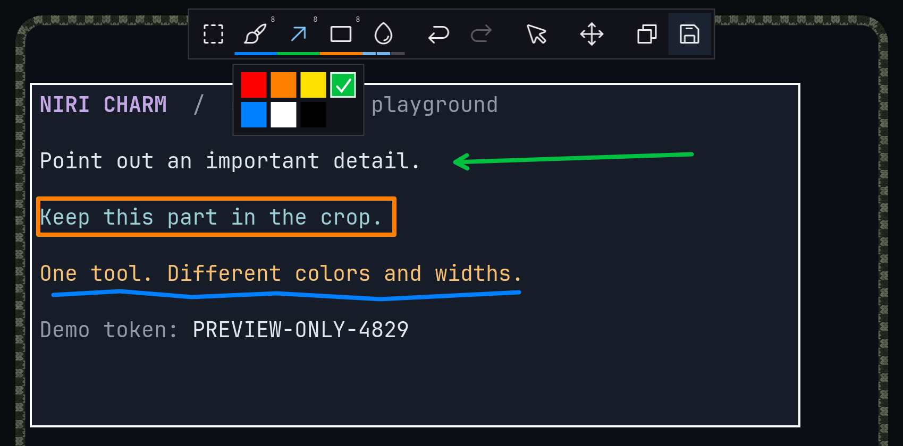</a>
      <h4>Arrow: green</h4>
      <p><code>arrow.color "#00c040"</code> is independent of the brush. Changing tools preserves their separate colors.</p>
    </td>
    <td width="33%" valign="top">
      <a href="./img/screenshot-tool-colors-rectangle.png">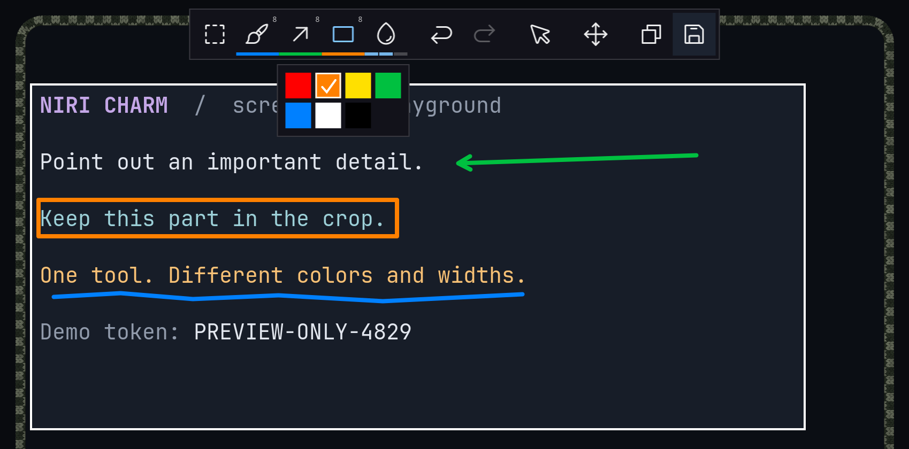</a>
      <h4>Rectangle: orange</h4>
      <p><code>rectangle.color "#ff8000"</code> colors the outline, not a fill. Its palette does not edit Draw or Arrow.</p>
    </td>
  </tr>
</table>

```kdl
screenshot {
    brush {
        width 8
        color "#0080ff"
    }
    arrow {
        width 8
        color "#00c040"
    }
    rectangle {
        width 8
        color "#ff8000"
    }
}
```

After the config reload completes, open a **new editor session** to use these initial colors and widths. An already-open editor keeps its current tool values. For an immediate change, use that tool's palette; only new strokes use the selected color. These screenshots keep the seven default swatches per tool. To replace those choices, see [Custom color palettes](#custom-color-palettes) below. Tool colors must be opaque; see [Brush, arrow and rectangle](#brush-arrow-and-rectangle).

### Custom color palettes

<p><code>palette</code> replaces a tool's default color pool: it controls both the available swatches and their order, not just the selected color. These close-ups show three different lists from the configuration below. Select a tool, then activate it again or press <code>C</code> to open its own palette.</p>

<table>
  <tr>
    <td width="33%" valign="top">
      <a href="./img/screenshot-custom-palette-draw.png">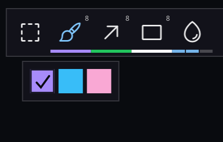</a>
      <h4>Draw: 3 pastel colors</h4>
      <p>Violet, sky blue, then pink. The list in <code>brush.palette</code> replaces the seven default swatches.</p>
    </td>
    <td width="33%" valign="top">
      <a href="./img/screenshot-custom-palette-arrow.png">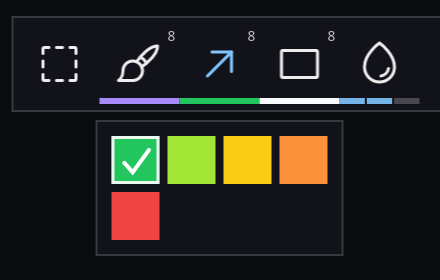</a>
      <h4>Arrow: 5 highlight colors</h4>
      <p>Green, lime, yellow, orange, then red. The fifth color starts a second row; the order follows <code>arrow.palette</code>.</p>
    </td>
    <td width="33%" valign="top">
      <a href="./img/screenshot-custom-palette-rectangle.png">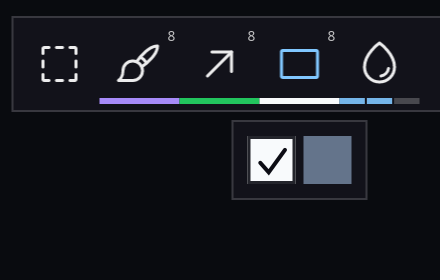</a>
      <h4>Rectangle: 2 neutral colors</h4>
      <p>Only white and slate grey. <code>rectangle.palette</code> is independent of both other tools' lists.</p>
    </td>
  </tr>
</table>

Merge these settings into your existing `screenshot` block:

```kdl
screenshot {
    brush {
        width 8
        color "#a78bfa"
        palette "#a78bfa" "#38bdf8" "#f9a8d4"
    }
    arrow {
        width 8
        color "#22c55e"
        palette "#22c55e" "#a3e635" "#facc15" "#fb923c" "#ef4444"
    }
    rectangle {
        width 8
        color "#f8fafc"
        palette "#f8fafc" "#64748b"
    }
}
```

`color` chooses the initial active color when the editor opens; **`palette` defines the pool of choices**. Each list accepts one to seven opaque colors. With the bundled `1`–`7` bindings, the number follows the configured order, left to right and then the next row: here `3` picks pink for Draw but yellow for Arrow. Choosing a swatch changes only that tool's future strokes, not existing edits.

### Blur strength examples

<p>Low, Medium and High use the same original demo text and the same rectangle below. Each blur was applied separately, not stacked over the previous level. The real button and tooltip show the selected strength above each result.</p>

<table>
  <tr>
    <td width="33%" valign="top">
      <a href="./img/screenshot-blur-low.png">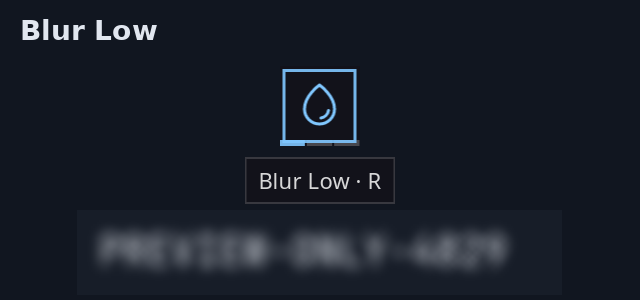</a>
      <h4>Low</h4>
      <p>The lightest smoothing. One segment is filled below Blur; text shapes remain more recognizable.</p>
    </td>
    <td width="33%" valign="top">
      <a href="./img/screenshot-blur-medium.png">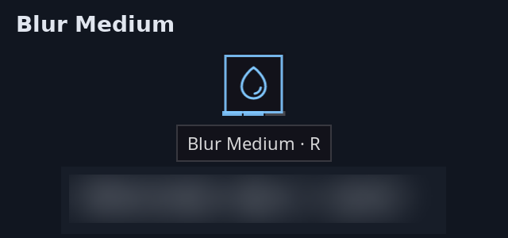</a>
      <h4>Medium</h4>
      <p>The default strength. Two filled segments indicate stronger smoothing of the same source details.</p>
    </td>
    <td width="33%" valign="top">
      <a href="./img/screenshot-blur-high.png">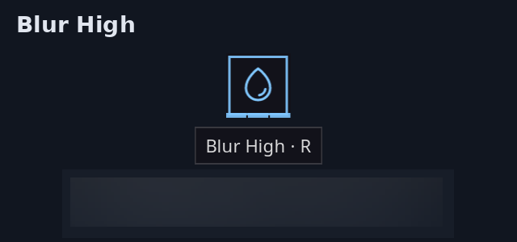</a>
      <h4>High</h4>
      <p>The strongest smoothing. All three segments are filled. This still does not make blur secure redaction.</p>
    </td>
  </tr>
</table>

Select Blur, hover its button, then scroll or use the configured `Minus` / `Equal` bindings. The strength is captured when a blur gesture starts: changing it does not update completed regions. Undo and redraw a region to apply another strength. Blur affects the frozen background beneath drawings, not the drawings themselves.

**Do not rely on blur to protect sensitive information.** These examples deliberately use fake text. See [Blur](#blur) for overlap behavior and configuration.

### Undo and redo

<p>Each completed drawing or blur gesture is one history entry. Here Undo removes the blur and Redo restores exactly the same edit; the toolbar insets show which history buttons are available.</p>

[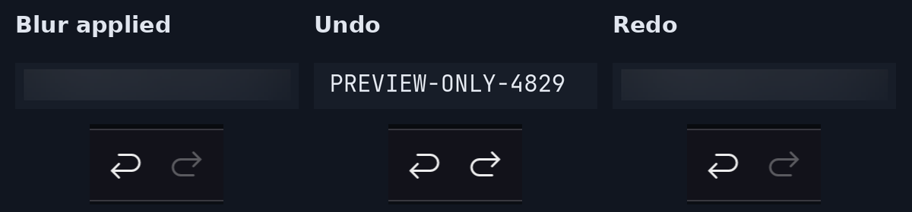](./img/screenshot-history.png)

Changing the tool, its color/width or the crop does not create a history entry. A new completed edit clears the redo stack. History lasts only until the editor closes. During a gesture, Undo discards the unfinished edit instead of committing it.

### Drawing with axis guides

<p>Axes constrain Draw, Arrow and Rectangle to horizontal or vertical movement. In this mid-drag capture, the arrow remains horizontal even though the pointer has moved below it. The dashed guides and the free pointer are editing aids, not exported marks.</p>

[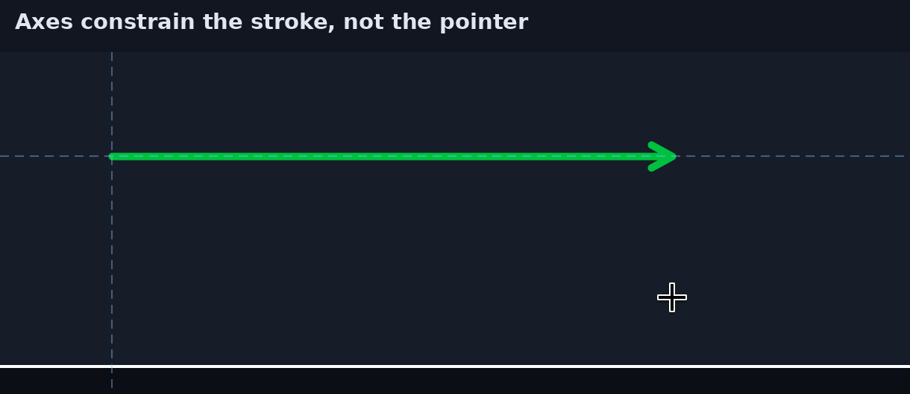](./img/screenshot-axes.png)

Click button **9** or press `X` to toggle the mode. Holding `Shift_L` enables it temporarily; releasing the key restores the toggle state. This is **axis constraint**, not a square/aspect-ratio lock and not crop movement. For Rectangle, setting width and then height uses the hold/reanchor sequence described in [Axis guides](#axis-guides).

### Axes and Draw

<p>These close-ups show the same mouse path with the button still held. Without axes, Draw follows the pointer freely. With axes enabled, the first movement chooses a horizontal or vertical ray and the stroke stays on that ray even when the pointer drifts away.</p>

<table>
  <tr>
    <td width="50%" valign="top">
      <a href="./img/screenshot-axes-draw-off.png">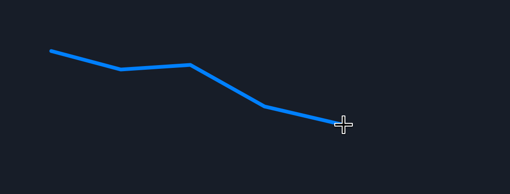</a>
      <h4>Axes off: freehand</h4>
      <p>The blue stroke follows both coordinates of the pointer, including every change of direction.</p>
    </td>
    <td width="50%" valign="top">
      <a href="./img/screenshot-axes-draw-on.png">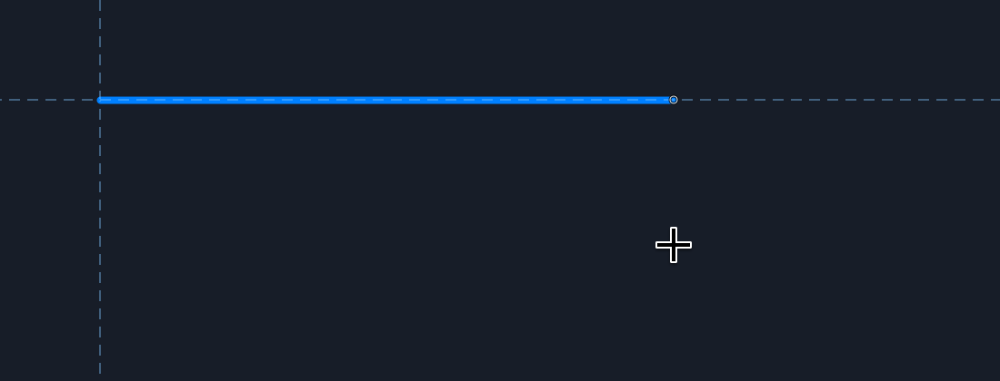</a>
      <h4>Axes on: straight stroke</h4>
      <p>The initial movement chose horizontal. The line stays level while the crosshair remains below its projected endpoint.</p>
    </td>
  </tr>
</table>

Use `X` for a persistent constraint or hold `Shift_L` temporarily with the bundled bindings. Guides and the free crosshair do not become part of the drawing.

### Axes and Rectangle

<p>Rectangle is already axis-aligned without axes. Axes constrain its moving opposite corner; they do not rotate the rectangle or force a square. The two held-axes stages below keep the first corner fixed and the mouse button down while setting width, then height.</p>

<table>
  <tr>
    <td width="33%" valign="top">
      <a href="./img/screenshot-axes-rectangle-off.png">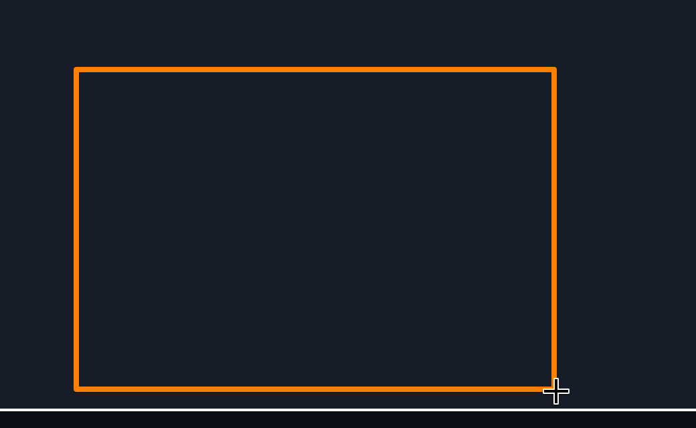</a>
      <h4>Axes off: both dimensions</h4>
      <p>The opposite corner follows the pointer horizontally and vertically. The outline remains an ordinary axis-aligned rectangle.</p>
    </td>
    <td width="33%" valign="top">
      <a href="./img/screenshot-axes-rectangle-width.png">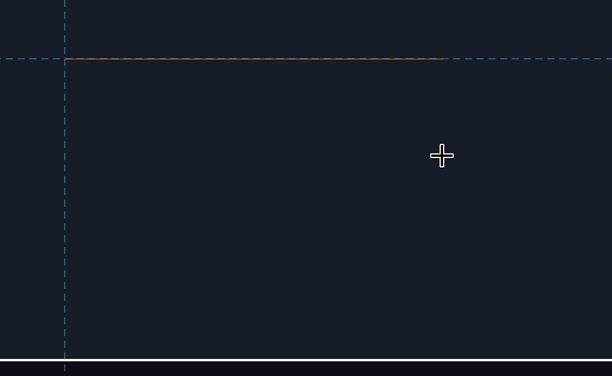</a>
      <h4>Hold axes: set width</h4>
      <p>Hold Shift and drag horizontally. Height is still zero, so the preview is only a thin line on the horizontal guide.</p>
    </td>
    <td width="33%" valign="top">
      <a href="./img/screenshot-axes-rectangle-height.png">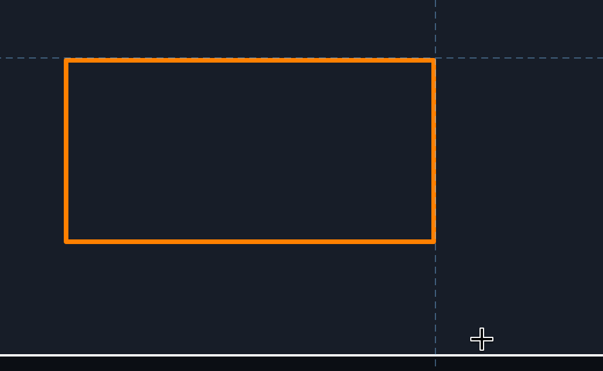</a>
      <h4>Reanchor: add height</h4>
      <p>Release and press Shift again, then move vertically. The guide moves to the drawn corner; the first corner and chosen width stay fixed.</p>
    </td>
  </tr>
</table>

For this sequence, start with the Axes toggle off. Hold `Shift_L`, press the mouse button at the first corner, then move horizontally. **Keep the mouse button down** and release/repress Shift **without moving the pointer between the key events**; this reanchors at the projected corner, not at the free crosshair. Move vertically to set height. Release the mouse to commit the one rectangle, then release Shift. See [Axis guides](#axis-guides) for ray switching and hold behavior.

### Including the captured cursor

<p>Button 8 controls the pointer that was frozen with the desktop when the editor opened, not the live pointer you use to operate the editor. The accent stripe under the cursor icon indicates inclusion; the icon shape stays the same in both states.</p>

[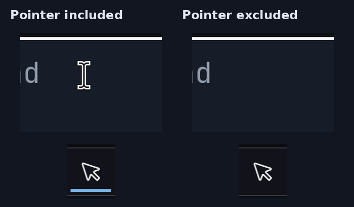](./img/screenshot-pointer.png)

Click the button or press `P` to toggle it. The setting affects both clipboard and file export. You can choose the initial state on the opening action, for example `screenshot show-pointer=false`.

### Copy, save and cancel

<p>Copy and Save both export the selected crop with its completed edits and close the editor on success. This is the actual saved image from the overview: the toolbar, magnifier, crop border and other editor overlays are not part of it.</p>

[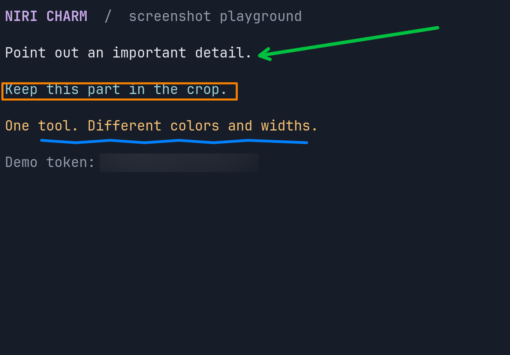](./img/screenshot-export.png)

- **Copy / `Ctrl+C`:** PNG clipboard only; no file is created.
- **Save / `Ctrl+S`:** save to `screenshot-path` and also copy to the clipboard. The file can be PNG, WebP or AVIF; clipboard images remain PNG.
- **`Enter`:** activate a keyboard-focused control, or save and copy when nothing is focused. `Ctrl+C` / `Ctrl+S` export directly regardless of keyboard focus.
- **`Escape`:** close the palette first, cancel an unfinished gesture next, or close the editor when there is nothing left to cancel. `Space` moves the crop while held; it does not save.

Finish the current mouse/touch gesture before exporting. Paths, formats and bindings are configured outside the appearance block; see [Opening, bindings and export](#opening-bindings-and-export).

### Default configuration

```kdl
screenshot {
    toolbar {
        position "top"
        align "center"
        margin top=8 right=8 bottom=8 left=8
        button-size 40
        icon-size 24
        background-color "#12121a"
        border-color "#ffffff29"
        border-width 1
        accent-color "#80c7ff"
        icon-color "#ffffffeb"
        disabled-icon-color "#ffffff4d"
        hover-color "#ffffff1f"
        pressed-color "#00000059"
        opacity 1.0
        drag-opacity 0.5
    }

    tooltips {
        enabled true
        font "Sans"
        font-size 11
    }

    selection {
        border-color "#ffffff"
        border-width 2
        dim-color "#000000"
        dim-opacity 0.5
        remember-selection true
    }

    brush {
        width 4
        color "#ff0000"
        palette "#ff0000" "#ff8000" "#ffe000" "#00c040" "#0080ff" "#ffffff" "#000000"
        open-palette-on-click true
        close-palette-on-select true
    }

    arrow {
        width 4
        color "#ff0000"
        palette "#ff0000" "#ff8000" "#ffe000" "#00c040" "#0080ff" "#ffffff" "#000000"
        open-palette-on-click true
        close-palette-on-select true
    }
    rectangle {
        width 4
        color "#ff0000"
        palette "#ff0000" "#ff8000" "#ffe000" "#00c040" "#0080ff" "#ffffff" "#000000"
        open-palette-on-click true
        close-palette-on-select true
    }
    axes {
        color "#80c7ff"
        opacity 0.4
        width 1
        dash-length 6
        dash-gap 4
        switch-threshold 8
    }

    blur {
        strength "medium"
    }

    magnifier {
        diameter 192
        border-width 2
        border-color "#ffffff"
        grid-color "#0000008c"
        pointer-gap 16
        initial-zoom 1
        show-from 2
        max-zoom 32
        grid true
        grid-from 4
        cross-highlight true
        cross-highlight-color "#a6d9f259"
    }
}
```

### Units and colors

Toolbar geometry, axis guide dimensions and magnifier diameter/gap/border width use logical pixels, so they follow output scaling. Selection border width and brush/arrow/rectangle widths use pixels of the captured frame.

UI colors support transparency; eight-digit HEX is `#RRGGBBAA`, not `#AARRGGBB`. Color alpha is multiplied by the element's opacity. For example, a half-transparent `dim-color` with `dim-opacity 0.5` produces quarter-opacity dimming.

Brush and palette colors must be fully opaque. Use `#RRGGBB` or an alpha of `ff`; translucent brush colors are rejected.

### Toolbar

| Setting               | Default       | Meaning                                                                    |
| --------------------- | ------------- | -------------------------------------------------------------------------- |
| `position`            | `"top"`       | Screen edge: `"top"` or `"bottom"`.                                        |
| `align`               | `"center"`    | Horizontal alignment: `"left"`, `"center"` or `"right"`.                   |
| `margin`              | All sides `8` | Independent non-negative `top`, `right`, `bottom`, `left` properties.      |
| `button-size`         | `40`          | Positive button size. Panel height is calculated automatically.            |
| `icon-size`           | `24`          | Positive SVG icon size, no larger than `button-size`.                      |
| `background-color`    | `"#12121a"`   | Panel background.                                                          |
| `border-color`        | `"#ffffff29"` | Panel outline.                                                             |
| `border-width`        | `1`           | Non-negative outline width; `0` removes it.                                |
| `accent-color`        | `"#80c7ff"`   | Active-control accent.                                                     |
| `icon-color`          | `"#ffffffeb"` | Normal icon color.                                                         |
| `disabled-icon-color` | `"#ffffff4d"` | Unavailable-control icon color.                                            |
| `hover-color`         | `"#ffffff1f"` | Hover background.                                                          |
| `pressed-color`       | `"#00000059"` | Pressed-control background.                                                |
| `opacity`             | `1.0`         | Resting opacity, from `0` to `1`.                                          |
| `drag-opacity`        | `0.5`         | Absolute opacity during a canvas/selection gesture, from `0` to `opacity`. |

`position "top"` uses the top margin; `"bottom"` uses the bottom margin. Center alignment centers the toolbar between the left and right margins, so unequal margins shift its center. On small outputs the toolbar scales down instead of wrapping its buttons.

The palette and tooltips open toward the center of the screen: below a top toolbar or above a bottom toolbar. Their positions are constrained to the available area. They share the toolbar theme.

`drag-opacity` is **not a multiplier** of `opacity`. It applies while selecting or moving the crop, drawing, or creating a blur rectangle. Clicking toolbar buttons or palette colors does not trigger it. Release or cancel restores normal opacity. Set both opacities to the same value to disable fading.

### Tooltips

| Setting     | Default  | Meaning                                                             |
| ----------- | -------- | ------------------------------------------------------------------- |
| `enabled`   | `true`   | Show tooltips on hover or keyboard focus. Set `false` to hide them. |
| `font`      | `"Sans"` | Font description.                                                   |
| `font-size` | `11`     | Positive font size.                                                 |

Shortcut labels reflect the configured bindings rather than a separate set of tooltip shortcuts. Tooltips appear at the configured resting opacity, including on a translucent toolbar; they stay hidden while the toolbar fades.

### Selection

| Setting              | Default     | Meaning                                                                  |
| -------------------- | ----------- | ------------------------------------------------------------------------ |
| `border-color`       | `"#ffffff"` | Crop frame color.                                                        |
| `border-width`       | `2`         | Non-negative frame width in captured pixels.                             |
| `dim-color`          | `"#000000"` | Tint outside the crop.                                                   |
| `dim-opacity`        | `0.5`       | Dimming opacity multiplier, from `0` to `1`; `0` disables dimming.       |
| `remember-selection` | `true`      | Restore the previous selection on the next editor opening when possible. |

Dimming affects only the frozen background outside the selected region, including inactive outputs. It does not dim your drawing or become part of the saved image. Selection is limited to one output.

### Brush, arrow and rectangle

| Setting                   | Default                  | Meaning                                                               |
| ------------------------- | ------------------------ | --------------------------------------------------------------------- |
| `width`                   | `4`                      | Integer stroke width, `1`–`128` captured pixels.                      |
| `color`                   | `"#ff0000"`              | Initial opaque drawing color.                                         |
| `palette`                 | Seven colors shown above | One to seven opaque colors, in display order.                         |
| `open-palette-on-click`   | `true`                   | Repeated activation of the selected colored tool toggles its palette. |
| `close-palette-on-select` | `true`                   | Close the palette after selecting a color.                            |

Palette numbering starts at 1: `screenshot-palette-color 1` selects the first configured swatch. Repeated RGB values remain separate swatches for pointer and keyboard navigation. The initial `color` need not occur in the palette. Colors and widths chosen in the editor affect new strokes, not existing drawings.

`brush`, `arrow` and `rectangle` accept the same settings above, but store independent colors, widths and palettes; they do not inherit custom brush settings. Each button has its own bottom color stripe and a width number in the top-right corner. The brush cursor outlines its actual captured-pixel diameter. Selecting a different tool never opens its palette; activating the selected tool again toggles its palette only when `open-palette-on-click` is enabled. `screenshot-tool` never opens it. The shared palette edits only the selected colored tool.

Drag an arrow from tail to head; its head scales with the captured width. Drag a rectangle between opposite corners; it has no fill. Each gesture previews live and becomes one undo/redo operation on mouse release. Escape cancels it. Changes to tool parameters never recolor or resize completed edits.

### Blur

`strength` accepts `"low"`, `"medium"` (default), or `"high"`. It is captured when a blur gesture starts, so changing it does not alter earlier blur rectangles.

The Blur button has three bottom segments filled from left to right. Its tooltip names the level without repeating the count. Clicking it only selects Blur. `screenshot-context "+1"` and `"-1"` change the keyboard-focused tool, falling back to the tool under the pointer. For Blur this changes strength without wrapping; absolute values `1`, `2`, `3` select low, medium, high. The command does not select the tool, and only new blur regions use the new strength.

Blur affects the frozen background beneath drawings, not the drawings themselves. Where regions overlap, high strength covers medium, and medium covers low, regardless of the order in which you draw them. Undo/redo still follows the order of edits. Blur is a visual effect, **not a guarantee that sensitive information cannot be recovered**.

### Axis guides

The axes mode is shared by brush, arrow and rectangle and survives tool switches. Its separate toolbar toggle sits before Copy/Save. Both dashed guides always use the same color and opacity; the chosen axis is not highlighted.

The configuration section is `axes`, not `axis`. It configures appearance and the switching threshold, not an initial enabled state: there is no `axes.enabled` setting. Axes start disabled; use the toggle, hold or explicit set action to enable them.

| Setting            | Default     | Meaning                                           |
| ------------------ | ----------- | ------------------------------------------------- |
| `color`            | `"#80c7ff"` | Guide color; supports alpha.                      |
| `opacity`          | `0.4`       | Alpha multiplier, from `0` to `1`.                |
| `width`            | `1`         | Positive line width in logical pixels.            |
| `dash-length`      | `6`         | Positive dash length in logical pixels.           |
| `dash-gap`         | `4`         | Positive gap in logical pixels.                   |
| `switch-threshold` | `8`         | Positive switching-zone radius in logical pixels. |

Before drawing, the intersection follows the pointer. Pressing the mouse anchors it; the initial movement chooses a horizontal or vertical ray. Returning to the intersection enters a small switching zone, preventing accidental tails on the opposite ray. Only drawing coordinates are constrained; the system pointer remains a free crosshair.

`screenshot-toggle-axes` toggles the mode; `screenshot-set-axes true` enables it explicitly. The local `screenshot-toggle-axes hold=true` bind enables it while its physical key is held. Releasing hold restores the toggle state. During a drag, releasing and pressing hold again reanchors at the current drawn point without jumping or completing the edit. At screen edges, it uses the visible, clipped point rather than an off-screen projection. For Rectangle, the first corner stays fixed: set the width, release/repress hold, then set the height. Only releasing the mouse completes the figure.

Hold also supports a mouse or stylus button. It ends only when that same physical control is released; releasing another button does not disable it. With multiple hold controls, the mode remains enabled until all are released. Bare modifier triggers such as `Shift_L` are supported for this action without changing ordinary key-binding matching.

Lost releases are handled conservatively: removing a device (including a virtual pointer), switching VT, suspending, or losing nested-window focus clears temporary axes holds, while preserving the explicit toggle state.

`hold` defaults to `false`. It is a local bind property, not an IPC argument: IPC `screenshot-toggle-axes` always toggles. Hold requires a physical release event, so wheel and touchpad scroll triggers are rejected. Held actions do not repeat even when the bind enables repeat.

```kdl
binds {
    A { screenshot-tool "arrow"; }
    D { screenshot-tool "rectangle"; }
    X repeat=false { screenshot-toggle-axes; }
    Shift_L repeat=false { screenshot-toggle-axes hold=true; }
    Minus { screenshot-context "-1"; }
    Equal { screenshot-context "+1"; }
    WheelScrollUp { screenshot-context "+1"; }
    WheelScrollDown { screenshot-context "-1"; }
}
```

### Context-sensitive adjustment

`screenshot-context` first uses the control focused by `screenshot-focus-next` or `screenshot-focus-previous`. Without keyboard focus it uses pointer hit-testing. A focused or hovered Draw, Arrow or Rectangle button changes its own stroke width; Blur changes its strength. Neither focus nor this command selects the tool. Select, palette controls and other UI absorb the command without zooming; with no focus, toolbar padding also blocks it and the canvas changes magnifier zoom. With neither focus nor a pointer, it is a no-op. Mouse movement clears keyboard focus and restores pointer-based routing. Each tool remembers its value independently. A bare integer sets an absolute value from `1` to `128`, clamped to the target: widths `1`–`128`, Blur `1`–`3`, magnifier rounded down to a power of two within `max-zoom`. Signed strings such as `"+1"` or `"-1"` adjust without wrapping. Tool parameters remain frozen during a gesture, while canvas zoom remains available. Explicit `screenshot-magnifier-zoom` ignores both focus and hover.

Configured `TouchpadScroll*` bindings accumulate continuous movement in 10-pixel steps, independently per axis and separately from wheel ticks. Unbound scroll input remains confined to the editor.

### Magnifier

| Setting                 | Default       | Meaning                                                               |
| ----------------------- | ------------- | --------------------------------------------------------------------- |
| `diameter`              | `192`         | Positive lens diameter in logical pixels.                             |
| `border-width`          | `2`           | Inward border width in logical pixels; non-negative, `0` disables it. |
| `border-color`          | `"#ffffff"`   | Border color, with alpha support.                                     |
| `grid-color`            | `"#0000008c"` | Grid line color, with alpha support.                                  |
| `pointer-gap`           | `16`          | Non-negative gap between pointer and lens, in logical pixels.         |
| `initial-zoom`          | `1`           | Starting zoom: `1`, `2`, `4`, `8`, `16`, or `32`.                     |
| `show-from`             | `2`           | Visibility threshold: `2`, `4`, `8`, `16`, or `32`.                   |
| `max-zoom`              | `32`          | Maximum zoom: `2`, `4`, `8`, `16`, or `32`.                           |
| `grid`                  | `true`        | Enable the pixel grid.                                                |
| `grid-from`             | `4`           | Grid threshold: `2`, `4`, `8`, `16`, or `32`.                         |
| `cross-highlight`       | `true`        | Highlight the central pixel's row and column.                         |
| `cross-highlight-color` | `"#a6d9f259"` | Color of that highlight.                                              |

`initial-zoom` and `show-from` must not exceed `max-zoom`. `grid-from` may exceed it; in that case the grid remains hidden until the maximum is raised. The grid also requires the lens to be visible.

The border is drawn inside the lens without changing its outer diameter. Its default is a single white outline, replacing the former black/white contour. A transparent border reveals the image beneath it. `grid-color` blends over the image; its default approximately preserves the previous grid darkening. It does not change `cross-highlight-color` or the central pixel marker. These colors and the border width update on configuration reload.

At the default `initial-zoom 1`, the lens starts hidden. To show it immediately, use `initial-zoom 2` with `show-from 2`. Zoom changes in discrete steps, not continuously. The lens shows the frozen image plus edits, without the toolbar or selection overlay.

### Customization example

A compact bottom-right toolbar, blue brush, persistent palette and immediately visible magnifier:

```kdl
screenshot {
    toolbar {
        position "bottom"
        align "right"
        margin bottom=20 right=20
        button-size 36
        icon-size 20
        background-color "#20242eee"
        accent-color "#89b4fa"
        opacity 0.95
        drag-opacity 0.3
    }
    selection {
        border-color "#89b4fa"
        dim-opacity 0.35
    }
    brush {
        width 6
        color "#0080ff"
        palette "#0080ff" "#ff8000" "#ffffff" "#000000"
        close-palette-on-select false
    }
    magnifier {
        diameter 160
        initial-zoom 2
        show-from 2
        max-zoom 16
        grid-from 8
    }
}
```

### Opening, bindings and export

The initial tool belongs to the opening action, not the appearance block. Bindings, file paths, formats and export quality are also configured **outside** `screenshot {}`:

```kdl
screenshot-path "~/Pictures/Screenshots/%Y-%m-%d_%H-%M-%S.{ext}"
screenshot-format "png"

binds {
    Print { screenshot show-pointer=false; }
    Mod+Print { screenshot tool="draw"; }
    Ctrl+Alt+W { confirm-screenshot format="webp" quality=85; }
    Ctrl+Alt+A { confirm-screenshot format="avif" quality=90; }
}
```

Opening tools are `"select"` (default), `"draw"`, `"arrow"`, `"rectangle"` and `"blur"`. See [Key Bindings](./Configuration:-Key-Bindings.md#screenshot-screenshot-screen-screenshot-window) for editor actions.

Editor-local actions are no-ops while the editor is closed, including through IPC; they do not interrupt an unrelated touch gesture or grab.

`quality` applies only to that export: WebP accepts `0`–`100` (lossy, including at `100`), AVIF accepts `1`–`100`. Without it, WebP is lossless and AVIF uses quality `90`. PNG and clipboard-only exports ignore quality; clipboard images always remain PNG. There are no quality settings inside the appearance block. See [screenshot-format](./Configuration:-Miscellaneous.md#screenshot-format) and [screenshot-path](./Configuration:-Miscellaneous.md#screenshot-path).

`screenshot-confirm` activates the keyboard-focused control; without focus it saves and copies. `confirm-screenshot` exports regardless of focus. Neither exports an unfinished gesture. `screenshot-cancel` closes the palette, cancels the current gesture, then closes the editor on subsequent calls; `cancel-screenshot` immediately discards the session.

A cancelled touch sequence discards its unfinished drawing, restores an interrupted crop selection, and applies any deferred configuration reload. It does not close the editor or cancel a mouse-owned gesture. A new touch sequence can start immediately, including with the same touch slot.

### Full-feature demo configuration

The repository example `resources/knit-desktop.kdl` exposes all editor actions and independent tool settings. It is a demo, not the default configuration above: it starts Zed, Obsidian and two Ghostty windows. Run it from an existing Wayland session with `./target/debug/niri --config resources/knit-desktop.kdl`.

| Demo binding | Action |
| --- | --- |
| `Alt+U` / `Print`; `Alt+Shift+U` | Open Select; open Draw without the captured pointer |
| `V`, `B`, `A`, `D`, `R` | Select, Draw, Arrow, Rectangle, Blur |
| `C`; `1`–`7` | Toggle palette; select a swatch |
| `Tab` / `Shift+Tab`; `-` / `=` or wheel | Move focus; adjust the focused control, otherwise pointer context |
| `Ctrl+wheel`; `F11` / `F12` | Explicit lens steps; absolute 1× / 32× |
| `X`; hold left `Shift` or right mouse | Toggle axes; temporarily enable axes |
| Arrows; `Ctrl+arrows`; `Shift+arrows`; hold `Space` and drag | Move crop 1 px; move 20 px; resize 1 px; move with pointer |
| `Ctrl+Z`; `Ctrl+Shift+Z` / `Ctrl+Y` | Undo; redo |
| `P`; `F3` / `F4` | Toggle captured pointer; explicitly show / hide |
| `F1` / `F2`; `F5` / `F6` | Open / close palette; enable / disable axes |
| `F7`, `F8`, `F9` | Set brush orange, arrow green, rectangle blue without selecting the tool |
| `F10` | Set context to 8: width 8, Blur clamped to 3, or canvas zoom 8× |
| `Enter`; `Escape`; `Ctrl+Escape` | Confirm focus or save; cancel one step; discard immediately |
| `Ctrl+C` / `Ctrl+S` | Copy only / save and copy |
| `Ctrl+Alt+P` / `Ctrl+Alt+W` / `Ctrl+Alt+A` | Export PNG / WebP quality 85 / AVIF quality 90 |
| `Ctrl+Print` / `Alt+Print` | Capture screen / window without the editor |

The demo starts with a red 4 px brush, green 8 px arrow and blue 6 px rectangle. The arrow palette stays open after color selection; repeated activation of Rectangle does not open its palette (use `C` or `F1`). These differences are intentional checks of independent settings. Existing annotations retain their original color and width.

### Reloading and validation

Configuration reload updates the open editor's theme, geometry and palette. During a gesture, application is deferred until release or cancel, so controls do not move between press and release.

- Reload preserves the current tool, each tool's color and width, crop and undo/redo history.
- `brush`, `arrow` and `rectangle` colors/widths and `magnifier.initial-zoom` are defaults for the next opening; `remember-selection` also affects the next opening.
- A selected color remains selected even if removed from the palette; it simply has no highlighted swatch.
- Keyboard focus keeps the same matching swatch when possible, follows its color if the palette is reordered, and returns to the tool button if that color is removed.
- A lower `max-zoom` clamps the current zoom. Magnifier thresholds and appearance update with the applied configuration.
- Changing configured `blur.strength` updates the current strength for new blur gestures only. Unrelated reloads preserve the strength chosen in the editor.

Sizes must be finite and positive; margins and border widths must be finite and non-negative. Opacities must be within `0`–`1`. Contradictory values specified together, such as `icon-size > button-size`, `drag-opacity > opacity`, or `show-from > max-zoom`, are rejected.

When partial settings are merged, including through [include files](./Configuration:-Include.md), unspecified values are retained. To keep merged settings valid, the effective button size, resting opacity and maximum zoom are raised when needed to accommodate the icon size, drag opacity and zoom thresholds. Set both sides of a constraint explicitly when lowering them.

Validate your configuration before trying it:

```sh
niri-charm validate --config "${XDG_CONFIG_HOME:-$HOME/.config}/niri-charm/config.kdl"
```
