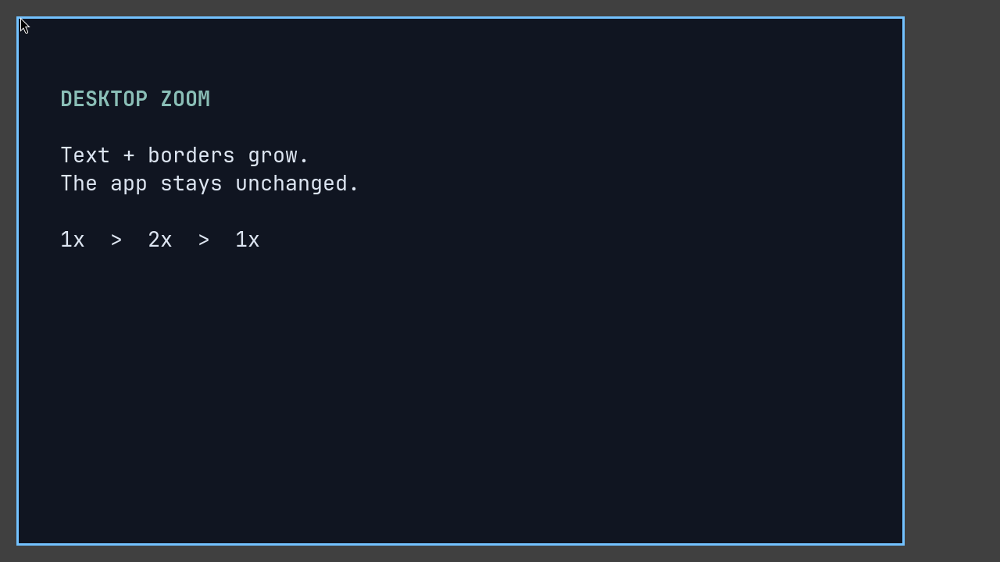
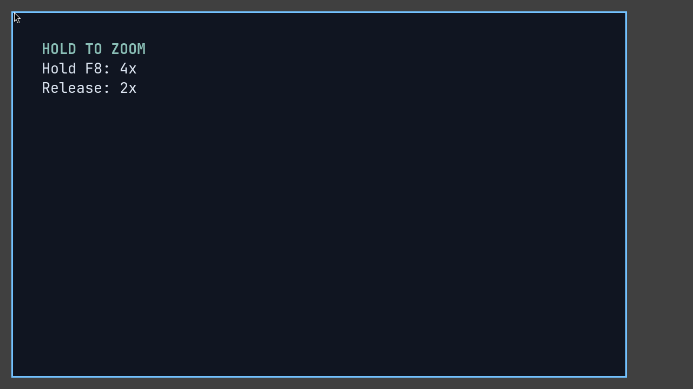
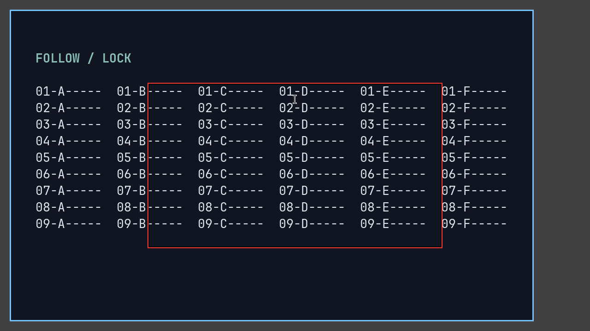
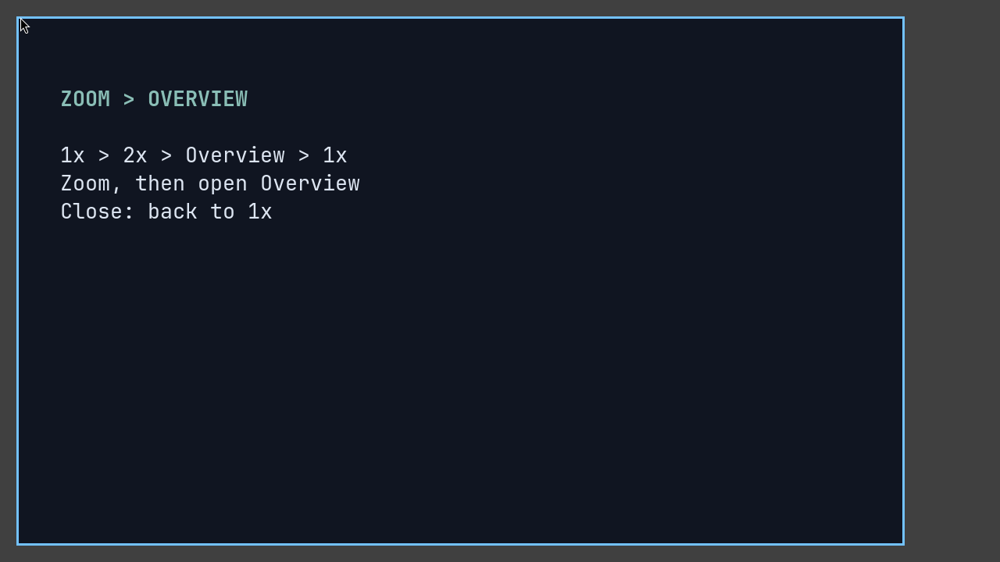
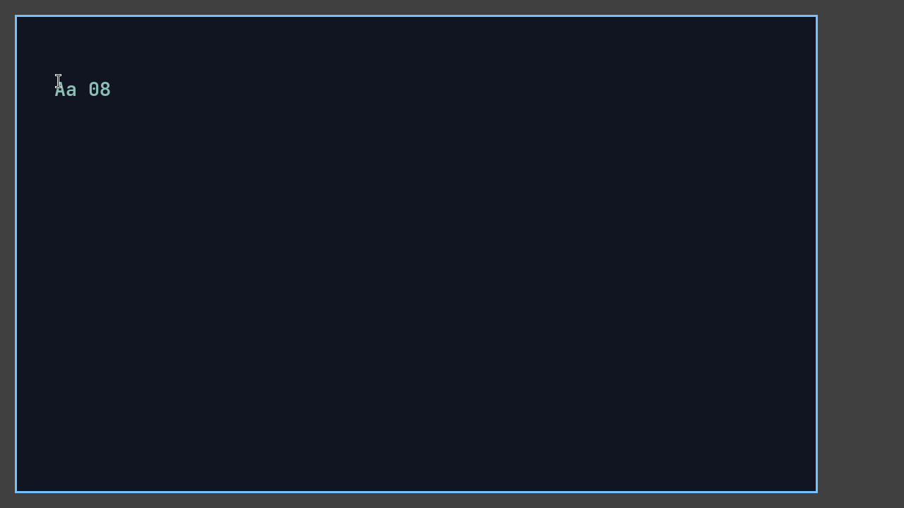

### Overview

<sup>Since: fork</sup>

Desktop zoom magnifies existing textures without changing output scale, window geometry or application DPI. The pointer keeps its normal size. For permanent UI sizing, use [output scaling](./Configuration:-Outputs.md#scale).

<table>
  <tr>
    <td width="50%" valign="top">
      <a href="./img/zoom-toggle.webp"></a>
      <h4>Toggle a preset</h4>
      <p><code>zoom 2.0 lock=true</code>: 1× → 2× → 1×.</p>
      <p><a href="#actions">Actions</a></p>
    </td>
    <td width="50%" valign="top">
      <a href="./img/zoom-hold.webp"></a>
      <h4>Hold, then restore</h4>
      <p>1× → 2× → hold 4× → release to 2× → reset 1×. Here <code>F8</code> triggers <code>zoom 4.0 hold=true</code>.</p>
      <p><a href="#hold-and-restore">Hold bindings</a></p>
    </td>
  </tr>
  <tr>
    <td width="50%" valign="top">
      <a href="./img/zoom-follow-lock.webp"></a>
      <h4>Follow or lock the view</h4>
      <p><code>zoom-lock</code> pauses pointer following. Red marks the deadzone.</p>
      <p><a href="#following-and-lock">Following and lock</a></p>
    </td>
    <td width="50%" valign="top">
      <a href="./img/zoom-overview.webp"></a>
      <h4>Enter Overview</h4>
      <p>1× → 2× → Overview → 1×.</p>
      <p><a href="#overview-and-other-ui">Overview and captures</a></p>
    </td>
  </tr>
</table>

### Quick start

No zoom bindings are enabled by default. Merge these examples into your `binds` block:

```kdl
binds {
    Mod+Z repeat=false { zoom 2.0; }
    Mod+X repeat=false { zoom 4.0 hold=true; }
    Mod+0 { reset-zoom; }
    Mod+WheelScrollUp { zoom-in; }
    Mod+WheelScrollDown { zoom-out; }
    Mod+L repeat=false { zoom-lock; }
    Mod+Shift+L repeat=false { zoom-lock hold=true; }
}
```

[`Mod`](./Configuration:-Key-Bindings.md#overview) normally means Super on a desktop, Alt when nested. Wheel direction follows `natural-scroll`; `repeat=false` prevents repeated toggles.

### Actions

Each output has independent zoom and lock state. Actions target the output under the pointer, falling back to the focused output.

| Action | Effect |
| --- | --- |
| `zoom-in` / `zoom-out` | Multiply/divide the target by `increment-factor`, within 1×–`max-zoom`; snap near 1×. |
| `set-zoom-level 2.0` | Set an absolute level, at least `1`, capped by `max-zoom`. |
| `reset-zoom` | Return to 1×. |
| `zoom 2.0` | Toggle: if the target exceeds 1×, reset; otherwise enter the preset, which must exceed `1`. |
| `zoom-lock` | Toggle pointer-follow locking without changing the level. |

Commands retarget the current animation using its destination, not an intermediate frame. Presets remain adjustable by wheel or pinch.

`zoom 2.0 lock=true` anchors on the pointer and locks immediately; toggling off clears the lock. Output bounds can limit anchoring.

### Following and lock

Outside the centered deadzone, the viewport follows until the pointer reaches its edge or the viewport reaches output bounds—even if the mouse stops. Following can run during zoom-in. Speed grows with distance outside the deadzone; diagonal motion adds no speed boost.

While locked:

- Pointer movement cannot pan or leave the visible viewport.
- `zoom-in` / `zoom-out` capture a fixed pointer anchor per command.
- Absolute changes, animated restoration and pinches begun locked use the viewport center.
- Locking mid-pinch freezes its focal point; unlocking preserves that gesture's anchor mode.

### Hold and restore

- `zoom 4.0 hold=true`: press for 4×; release to restore the saved target level and, when unlocked, focal position on the original output.
- Add `lock=true` to lock around the pointer during the hold and restore the earlier lock state on release.
- `zoom-lock hold=true`: temporarily invert the lock, then restore it.

Normal zoom controls work during a hold. Pointer interaction or another command can interrupt restoration. For overlapping locking holds, the latest press wins; releasing it reapplies any remaining override, and the last release restores the original lock.

Hold actions require a release-capable binding: **no wheel triggers or IPC**.

### Default configuration

Root-level settings; all are optional. Pinch and debug overlays are disabled by default.

```kdl
zoom {
    max-zoom 10.0
    increment-factor 1.2
    sampling "linear"
    deadzone-size 0.5
    follow-min-speed 80
    follow-max-speed 1400
    // pinch-fingers 3
    // debug {
    //     deadzone
    //     focal-point
    // }
}
```

#### `max-zoom`

At least `1`; `1` prevents magnification. Reload immediately clamps displayed zoom, including locked outputs, and bounds in-progress commands and restoration.

#### `increment-factor`

Finite and greater than `1`. Applies only to `zoom-in` / `zoom-out`, not pinch or absolute levels.

#### `sampling`

[](./img/zoom-sampling.webp)

The loop uses `sampling "auto" threshold=4.0`: **1× → 2× linear → 4× nearest → 1×**, without reloading config.

| Setting | Filtering |
| --- | --- |
| `sampling "linear"` | Smooth interpolation; default. |
| `sampling "nearest"` | Sharp texture-pixel boundaries. |
| `sampling "auto" threshold=4.0` | Linear below 4×, nearest from 4×. |

Only `auto` accepts—and requires—a finite threshold greater than `1`. It uses the displayed camera scale, including animations, pinch and Overview transitions. At 1× or below, normal filtering applies.

Reload changes filtering without changing zoom. It affects desktop textures, not pointer sprites, compositor UI or internal blur passes. Nearest cannot remove application-rendered antialiasing; fractional scales can produce unequal pixel blocks.

#### `deadzone-size`

Fraction of output width and height, from `0` to `1`. `0` follows toward the center; `1` disables following without imposing lock-style pointer confinement. Output bounds still apply.

#### `follow-min-speed`

Speed just outside the deadzone, in displayed logical pixels/second. Must be finite and positive.

#### `follow-max-speed`

Speed approached near the output edge, in the same units. Must be finite, positive and at least `follow-min-speed`.

#### `pinch-fingers`

Unset by default: applications keep their pinches. Set an integer ≥ `2` to claim exactly that finger count at gesture start; **`3` leaves common two-finger application gestures available**.

Spread to zoom in, close to zoom out. Scaling respects `max-zoom` and snaps near 1×. Ending or cancelling keeps the current view. Pinch zoom is not claimed during session lock, Overview, screenshot/window-switcher UI or pointer grabs.

#### `debug`

- `deadzone`: red outline; a center crosshair when its size is `0`.
- `focal-point`: amber crosshair at the transform's fixed point; dimmed at 1×.

Visible on the output only, excluded from native captures, and hidden during Overview or the window switcher. The preview records the outer nested window to show these overlays.

### Animation

Configured separately under root `animations`; these are the defaults:

```kdl
animations {
    zoom {
        spring damping-ratio=1.0 stiffness=800 epsilon=0.0001
    }
}
```

Replace the spring with `off` for immediate level changes and deadzone adjustments. This animation also drives hold restoration, but not pinch. Overview uses its own animation. See [Animations](./Configuration:-Animations.md#zoom).

### Overview and other UI

| Surface | Behavior |
| --- | --- |
| [Overview](./Overview.md) | Animates from the current view, ends zoom and clears lock/holds/pinches. Closing returns to 1×. Zoom input is disabled while open and during transitions. |
| Lock screen | Unzoomed; stored zoom returns on unlock. |
| Screenshot editor / window switcher | Pause following without ending zoom or accumulating hidden follow time. |
| [Screenshot magnifier](./Configuration:-Screenshot.md#adjusting-tools-and-the-magnifier) | Independent; the editor owns wheel input while open. |
| Monitor captures | Include zoom and sampling, exclude debug overlays. |
| Window-only captures | Unzoomed. |

Mouse, touch and tablet hit testing matches the displayed scene. Unlocked pointer motion can cross differently zoomed outputs without recentering them; locked views confine it.

### IPC

All non-hold actions are available through `niri msg action`:

```sh
niri msg action zoom 2.0 --lock
niri msg action reset-zoom
niri msg --json zoom
```

The query returns per-output `output`, `level`, `target_level`, `effective_level`, `focal` and `locked`. `level` is displayed zoom; `target_level` is its destination; `effective_level` currently equals `level`. `focal` uses output-local logical coordinates.

Overview entry reports zoom 1× and unlocked, **not** its transitioning camera scale. See [IPC: Desktop Zoom](./IPC.md#desktop-zoom).
